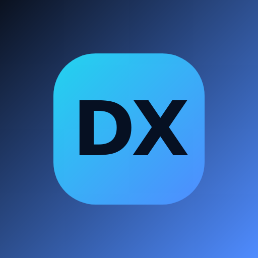
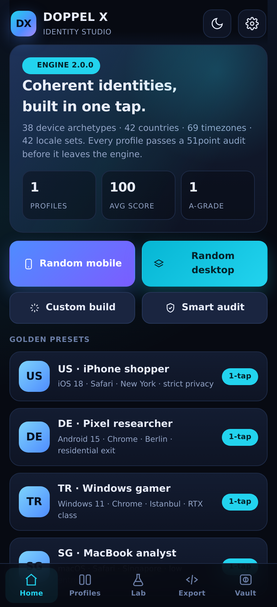
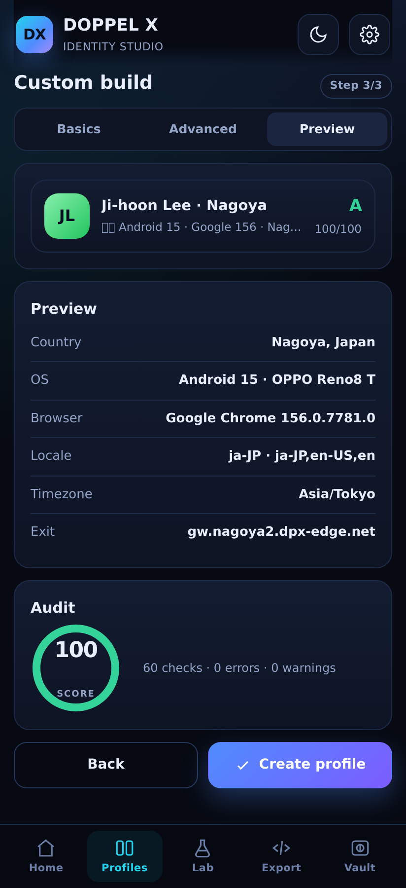
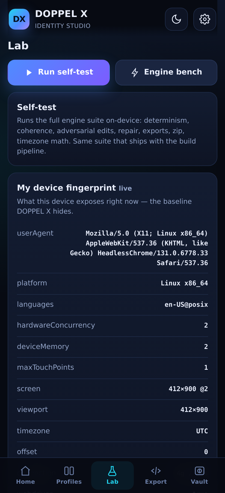

<p align="center">
  
</p>

<h1 align="center">DOPPEL X Identity Studio</h1>

<p align="center">
  <strong>Offline-first profile modelling, consistency auditing, and export tooling for authorised browser QA.</strong>
</p>

<p align="center">
  <a href="LICENSE"></a>
  <a href="docs/RELEASE_NOTES_v3.2.1.md"></a>
  <a href="docs/QUALITY.md"></a>
  <a href="SECURITY.md"></a>
</p>

> **Status — v3.2.1 source-release candidate.** This repository is clean,
> source-only, GitHub-ready, and deliberately contains no signing key, APK,
> AAB, proxy credential, account, user profile, or device session. It is not a
> promise of anonymity, undetectability, or suitability for third-party terms
> circumvention.

<p align="center">
  
  
  
</p>

## What it is

DOPPEL X is an offline studio for building **internally coherent test profiles**
and auditing relationships such as browser family ↔ user agent, locale ↔ time
zone, device ↔ display, and platform ↔ hardware metadata. It is designed for
browser compatibility QA, privacy research, reproducible test fixtures, and
controlled automation development on systems you own or are expressly
authorised to test.

### Core capabilities

- **Anchor-first profile model** — derives connected test fields from a small
  set of anchors rather than treating every field as unrelated random data.
- **Explainable audit and repair** — validates consistency, reports stable
  checks, and can re-derive dependent model fields after an edit.
- **Offline Android studio** — native Android shell with bundled local assets,
  app-private persistence, export through the Storage Access Framework, and no
  `INTERNET` permission in v3.2.1.
- **Browser companion** — editable source, standalone build script, core tests,
  and a DOM smoke test.
- **Runtime and export fixtures** — included for legitimate test environments;
  users must independently assess browser, platform, service, and legal
  constraints before using any output outside their own systems.
- **Termux:X11 ergonomics note** — an optional display-only helper for a
  high-density mobile canvas; it does not launch a browser or alter networking.

## Responsible-use boundary

Use this project only for your own software, systems, accounts, or engagements
where you have clear written permission. Do **not** use it to impersonate a
person, defeat access controls, evade platform enforcement, conceal fraudulent
activity, or submit claims, payments, credentials, or identity-verification
information to a third party.

A model that looks internally consistent cannot alter network-layer,
OS-layer, hardware, behavioural, reputation, policy, or legal constraints.
See [Security and limitations](docs/SECURITY_HARDENING.md).

## Quick start

### 1. Clone and inspect

```bash
git clone https://github.com/YOUR-ACCOUNT/doppelx-identity-studio.git
cd doppelx-identity-studio
npm install
npm run verify:source
```

### 2. Run the browser companion checks

```bash
npm run test:web:core
npm run build:web
npm run test:web:ui
```

`web/doppel.html` is generated locally and intentionally ignored by Git.
Open it in a current browser to inspect the companion UI.

### 3. Build and exercise the Android preview

```bash
npm run build:preview
npm run test:android
npm run test:android:preview
```

The Android end-to-end checks require Chromium supplied by Playwright:

```bash
npx playwright install chromium
```

### 4. Build a signed Android release

A release must be signed with **your own** private key. The project does not
create or embed a default key.

```bash
export ANDROID_HOME=/path/to/android-sdk
export BUNDLETOOL=/path/to/bundletool.jar
export DOPPELX_KEYSTORE=/secure/path/release.jks
export DOPPELX_KEY_ALIAS=your_alias
export DOPPELX_STORE_PASSWORD='set-in-your-secret-store'
export DOPPELX_KEY_PASSWORD='set-in-your-secret-store'

./android/build.sh
./android/build-aab.sh
```

See the full reproducible release procedure in [docs/RELEASE.md](docs/RELEASE.md).

## Quality gate

| Gate | Command | Purpose |
|---|---|---|
| Runtime mirror parity | `npm run sync:runtime:check` | Confirms generated/runtime copies are identical to one canonical source |
| Source boundary | `npm run verify:source` | Version parity, no legacy key/binary, Android hardening checks |
| JavaScript syntax | `npm run lint:syntax` | Parses all first-party JS/MJS files with Node |
| Web core | `npm run test:web:core` | Profile engine regression suite |
| Web UI | `npm run test:web:ui` | jsdom browser-companion smoke suite |
| Android preview | `npm run test:android` | Chromium E2E against bundled Android assets |
| Preview parity | `npm run test:android:preview` | Chromium E2E against generated single-file preview |

The exact pre-release evidence and limitations are recorded in
[docs/QUALITY.md](docs/QUALITY.md) and
[docs/RELEASE_NOTES_v3.2.1.md](docs/RELEASE_NOTES_v3.2.1.md).

## Repository layout

```text
.
├── android/                    Android app source, build scripts, preview tests
│   ├── app/                    Manifest, Java shell, resources, offline web assets
│   ├── tools/                  Preview builder and Playwright E2E suite
│   ├── build.sh                Signed APK build (requires your secrets)
│   └── build-aab.sh            Signed AAB build (requires your secrets)
├── web/                        Browser companion source, tests, MV3 fixture source
├── integrations/termux-x11/    Display-only Termux:X11 guidance/helper
├── scripts/                    Source verification, syntax, and mirror tooling
├── assets/                     Product icon, feature graphic, selected screenshots
├── docs/                       Architecture, security, release, quality, ADRs
└── .github/                    CI, CodeQL, Dependabot, issue templates
```

## Design and security changes in this release

`v3.2.1` is a release-engineering and hardening update from the reviewed
v3.2.0 source:

- removes the public release key, prebuilt artifacts, duplicate artifacts, and
  machine-specific build paths;
- requires caller-supplied signing values through environment variables;
- turns off Android backup, removes the app's network permission, blocks
  cleartext traffic, enables Safe Browsing, and restricts WebView navigation;
- fixes the Storage Access Framework output-stream handling and removes an
  unused in-app network diagnostic bridge;
- installs GitHub CI, CodeQL, Dependabot, source manifests, contribution and
  security policies, a release checklist, and deterministic runtime mirroring;
- documents the Termux:X11 display configuration separately from all profile
  and networking settings;
- excludes the prior unauthenticated network/relay/harvesting component from
  this public source package. See [ADR-001](docs/ADR-001-PUBLIC-RELEASE-BOUNDARY.md).

## Contributing and support

- Read [CONTRIBUTING.md](CONTRIBUTING.md) before opening a pull request.
- Report security issues privately as described in [SECURITY.md](SECURITY.md).
- Follow [CODE_OF_CONDUCT.md](CODE_OF_CONDUCT.md) in project spaces.
- Releases are maintained through [docs/RELEASE.md](docs/RELEASE.md).
- راهنمای فارسی ایجاد و انتشار repository: [docs/PUBLISH_TO_GITHUB_FA.md](docs/PUBLISH_TO_GITHUB_FA.md).

## License

Copyright © 2026 the DOPPEL X contributors. Licensed under the
[MIT License](LICENSE).
